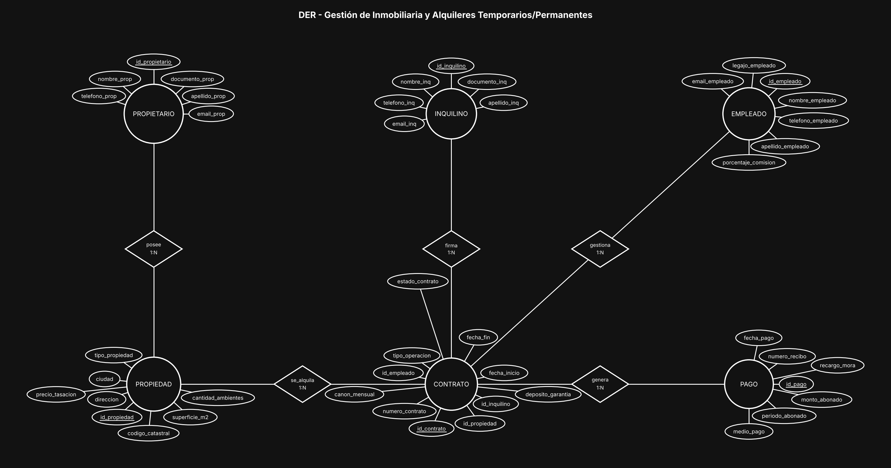
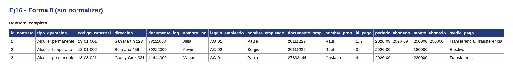
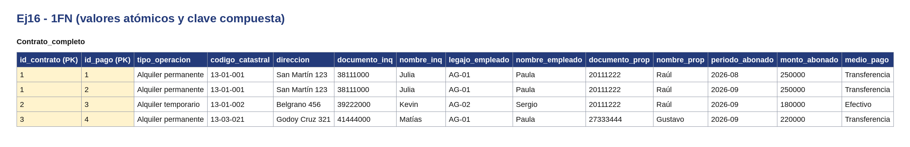
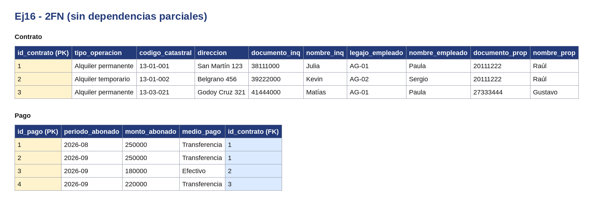
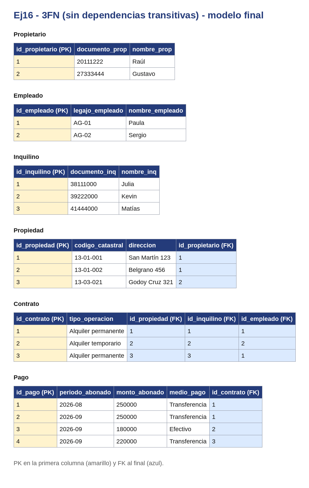

# BaseDeDatos-U2-Ej16-Inmobiliaria

Base de Datos - Unidad 2 - Ejercicio 16

## Consigna

Modelar el sistema centralizado de una inmobiliaria: cartera de propiedades con sus propietarios, inquilinos, agentes de la firma, contratos de locación y registro de los pagos mensuales del canon.

## Lógica

**PROPIETARIO 1:N PROPIEDAD.** El enunciado es explícito: una propiedad pertenece a un único propietario, y un propietario puede tener varias en cartera. Si la agencia admitiera condominios (varios dueños por inmueble) haría falta una intermedia `propietario-propiedad` con el porcentaje de cada uno.

**CONTRATO como entidad asociativa de tres vínculos.** Es el núcleo del modelo: relaciona PROPIEDAD, INQUILINO y EMPLEADO, y cada relación es 1:N hacia el contrato (una propiedad tiene muchos contratos a lo largo del tiempo, un inquilino puede alquilar varias unidades, un agente gestiona muchas operaciones). No puede resolverse como un rombo simple porque tiene atributos propios abundantes y porque de él cuelgan los pagos.

**La modalidad va como atributo `tipo_operacion`,** con valores Alquiler temporario / Alquiler permanente / Venta. La diferencia entre temporario y permanente es de duración y no cambia la estructura de datos, así que no justifica entidades distintas. La venta sí es un caso distinto: no tiene canon, ni depósito, ni pagos mensuales, así que esos campos quedarían en NULL. Si el profesor pide evitar esos NULL, la alternativa es una especialización: una entidad OPERACION con los datos comunes y dos subentidades (ALQUILER y VENTA) con los suyos.

**PAGO como entidad 1:N del contrato, nunca como atributo.** Los pagos son muchos y desconocidos de antemano (uno por mes de vigencia): meterlos en el contrato obligaría a columnas repetidas y rompería la primera forma normal. `periodo_abonado` es el mes que se está cancelando y es distinto de `fecha_pago`, que es cuándo se abonó efectivamente: de la diferencia entre ambos sale el `recargo_mora`.

**Propietario e inquilino como entidades separadas.** Se modelaron así porque el desarrollo requerido las pide por separado, pero conviene tener presente el trade-off: comparten exactamente los mismos atributos y una misma persona puede ser dueña de un inmueble e inquilina de otro, con lo cual quedaría cargada dos veces. La alternativa más prolija es una única entidad PERSONA con el rol determinado por la relación en la que participa (dueña en `posee`, locataria en `firma`), o una especialización con PERSONA como padre.

**Restricciones de integridad a considerar:** una propiedad no puede tener dos contratos de alquiler con períodos solapados; `fecha_fin` posterior a `fecha_inicio`; el propietario de una propiedad no debería figurar como inquilino de su propio inmueble; UNIQUE sobre (`id_contrato`, `periodo_abonado`) para que no se registre dos veces el mismo mes; y `recargo_mora` mayor a cero solo cuando la fecha de pago supera el vencimiento del período.

**Convención de claves.** Toda entidad lleva como PK un identificador propio `id_<entidad>` (subrayado en el diagrama) y al menos 5 atributos además del id; el código o documento de negocio (`dni`, `codigo_*`, `legajo`, etc.) queda como atributo común con restricción UNIQUE. Las entidades intermedias de las relaciones N:M llevan los tres ids: el propio y las dos FK de las entidades que unen (UNIQUE compuesto sobre ambas FK).

## Resultado

---

## Normalización

Se normaliza el documento `Contrato` con sus registros de `Pago`. En todas las tablas la PK va en la primera columna y las FK al final. Los datos son de ejemplo.

**Forma 0.** Una sola tabla con todo junto. Hay celdas con listas: cada contrato puede tener varios registros de pago.

**1FN.** Cada elemento de la lista pasa a su propia fila y la clave queda compuesta: (`id_contrato`, `id_pago`).

**2FN.** Los datos de contrato dependen solo de `id_contrato`, así que van a `Contrato`. `Pago` queda aparte con su propio id y la FK a `Contrato`.

**3FN.** Los datos de `Propiedad`, `Inquilino`, `Empleado` y `Propietario` dependen de su propio identificador y no de la PK de contrato, así que pasan a tablas aparte. En el modelo final cada tabla usa su id propio.

---

## SQL

El script `script.sql` crea las tablas con sus claves primarias y foráneas y carga datos de ejemplo. Está probado en SQLite (con `PRAGMA foreign_keys = ON;`).
